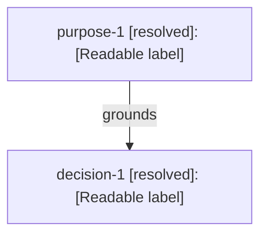

# Output Template

Use this template for the final or user-requested artifact. Replace every bracketed instruction with project-specific content. Keep every section in the order shown. If a section has no entries, write `None.` beneath its heading. Do not invent entries to fill a section. Do not leave placeholder rows or bracketed instructions in the finished artifact.

````markdown
# [Decision topic]

## Status

| Field | Value |
| --- | --- |
| Resolution | [Resolved, partially resolved, or unresolved] |
| Depth | [Shallow, standard, or deep] |
| Scope | [What this decision graph covers] |
| Sources | [Vision, map milestone, or other inputs, or `None.`] |

## Purpose

- **Root purpose:** `purpose-1` — [The outcome that grounds downstream choices]
- **For whom:** [Who benefits]
- **Desired change:** [What should become different]
- **What done looks like:** [The finished result a demanding user would accept, described in plain words. Include the quality bar.]
- **Constraints:** [Material limits with `constraint-*` IDs, or `None.`]
- **Non-goals:** [Explicit exclusions, or `None.`]

## Decision Graph



[Replace the example with the concise graph. If Mermaid is unavailable, use an indented relationship map with the same node IDs and labeled relationships.]

## Decision Register

| ID | Status | Decision | Why | Rejected alternatives |
| --- | --- | --- | --- | --- |
| `decision-1` | [resolved or provisional] | [Chosen direction] | [Grounding node IDs and concise rationale] | [Consequential alternatives and why they were not chosen] |

## Facts

| ID | Fact | Source |
| --- | --- | --- |
| `fact-1` | [Known or researched fact that grounds a decision] | [Source or origin] |

## Assumptions and Open Questions

| ID | Status | Item | What it affects | How work proceeds |
| --- | --- | --- | --- | --- |
| `assumption-1` | [provisional, open, or deferred] | [Unverified belief or unresolved choice] | [Decision or outcome affected] | [Working assumption to use, or why this blocks work] |

## Left to the Implementer

- [Choice delegated to implementer judgment, and the outcome that matters]

## Handoff

### Settled

- [What later work may treat as decided]

### Still Open

- [What later work must treat as provisional, open, or deferred]

### Next Step

[The next action enabled by this graph, or `None.` if the user requested clarification only.]
````

## Template Rules

- Use the exact node IDs from the graph in every table and cross-reference.
- Use only `resolved`, `provisional`, `open`, or `deferred` for node status. The artifact-level resolution may be `Resolved`, `Partially resolved`, or `Unresolved`.
- Keep the same sections at every depth. Change the amount of detail, not the structure.
- Put one atomic item in each table row. Add rows as needed.
- Make register rows stand alone.
- Keep facts in **Facts** and unverified beliefs in **Assumptions and Open Questions**.
- State material alternatives even when the user accepted the recommendation quickly.
- For an interrupted path, keep the same template, mark the artifact `Unresolved` or `Partially resolved`, and make blockers explicit in **Assumptions and Open Questions**.
- If the visual omits detail for readability, preserve it in the decision register or the relevant supporting table.
